# Chapp

A voice-first lab companion that knows every vial in your kit. Tell Chapp which kit you are running: it finds the
vendor's manual and reads it into a structured protocol, recognizes each bottle from one photo or video of your kit,
and walks you through the run with the right bottle, the right volume and the right timer on screen.

The name is *chaperone* + *app*. Molecular chaperones such as heat shock proteins help other proteins fold and stay
stable under stress without doing their work for them; Chapp does the same for the person at the bench.

Chapp is one of them. Its body is Hsp16.5, the small heat shock protein of *Methanococcus jannaschii*, a
hyperthermophilic archaeon from deep-sea hydrothermal vents, as its crystal structure has it
([PDB 1SHS](https://www.rcsb.org/structure/1SHS); Kim, Kim & Kim, *Nature* 1998,
[doi:10.1038/29106](https://doi.org/10.1038/29106)): 24 identical subunits closed into a hollow ball 12 nm across,
with eight triangular and six square windows. Each subunit is 16 round lumps of gel at its own place in the cage,
rebuilt from the PDB file's atoms by `scripts/chapp-model/body.ts`, and the face goes on top. Every subunit is a whole
piece of its own, so three quick taps on the big Chapp take it apart into its 24 subunits for a moment (left,
`scripts/chapp-model/apart.ts`). The app icon is the same cage without the face, seen straight down one of its
four-fold axes into a square window (right).

<p align="center">
  
  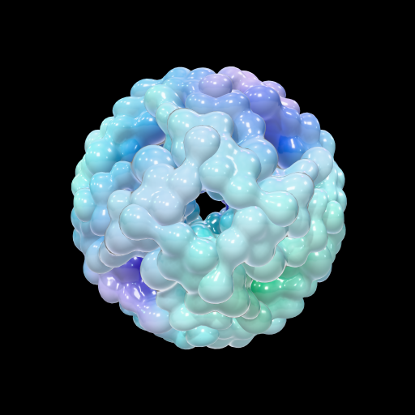
</p>

**[▶ Demo video](#)** · **[Run it yourself](#run-it)**

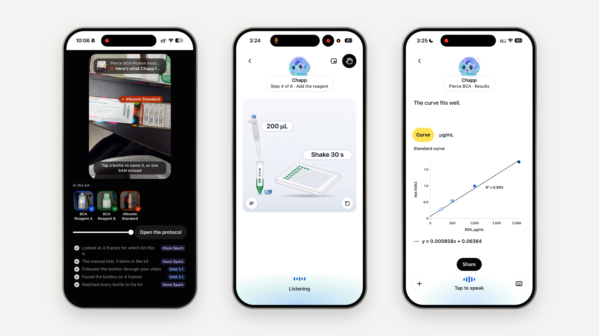

**Built for the [Meta Global AI Developer Hackathon](https://cerebralvalley.ai/e/meta-ai-developer-hackathon)** (Oct 26 – Nov 4, 2026, Indie Developer track).
Everything in this repository was written during the hackathon, starting October 27, 2026:

- **Oct 27–28**: the screens, the protocol format, and reading a manual with Muse Spark
- **Oct 29–30**: the conversation, voice, SAM on the kit photos, and the step pictures
- **Oct 31 – Nov 1**: the conversation as one thread with tools, and the benchmark of eleven models
- **Nov 2–4**: the kit video, the front assistant and its specialists, bottles made whole, and the demo video

## Why Chapp

AI is moving faster every year, and so are lab automation and robots. Yet most biology experiments are still done by
people, by hand, and the way they are done has barely changed in decades: a paper protocol on the bench, a pen, a
notebook. Chapp keeps the person at the bench and takes away the paper. The vendor's manual becomes steps on screen,
the bottles in them are the ones in front of you, and what you say is written into the run.

## What it does

- **Find the protocol.** Say the kit ("Pierce BCA"). Chapp finds the vendor's manual on the web and reads it, steps
  first.
- **Know your kit.** One photo or video of the bottles: SAM 3.1 outlines each bottle and Muse Spark reads the labels. A
  bottle it could not read is a guess the user confirms, never assumed. Each bottle, cut out, is the one the steps
  show.
- **Plan the plate.** The number of samples and replicates sets the standards, the working reagent and the plate
  layout. The app computes them; a model never does.
- **Run it hands-free.** One step at a time, the user's own bottles in the picture, every volume and timer big enough
  to read from arm's length. Gloves on, Chapp keeps listening.
- **Change the run by voice.** "A B C D ok", "Redo B", "B3 has a bubble, use H12", "add a well for a positive
  control": Plan, Run, Results and Share all follow, and a bad well is never read.
- **Read the plate.** A plate reader's export (Gen5, SoftMax Pro, Tecan, BMG) is parsed without a model; a photo of the
  reader's screen goes to Muse Spark, and the user confirms what it read. Results subtracts the blank and reads each
  sample off a straight regression line through the standards.
- **Share.** The protocol, the plan, the plate changes and, if you choose, the results travel in a QR code.
- **Ask any time.** Chapp answers with the manual's page and draws cards ([A2UI](https://github.com/google/A2UI)) where
  a card is clearer. It listens but stays silent: every answer is on screen.

## Meta models

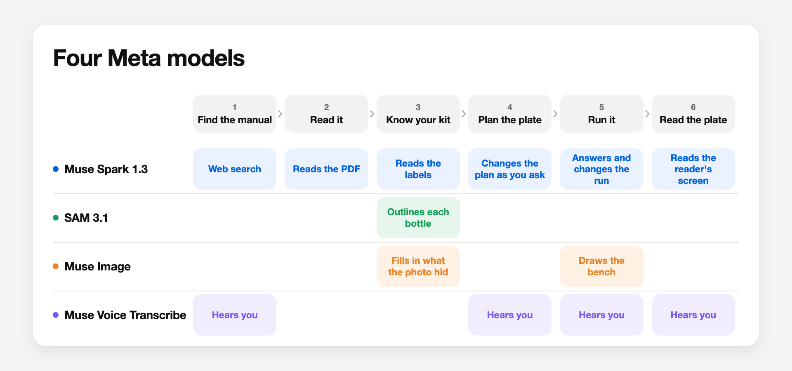

| Model | What Chapp uses it for |
|---|---|
| **Muse Spark 1.3** | Finding the vendor's manual (web search), reading it into a protocol, reading the kit and its labels, reading a photo of the plate reader, and the conversation: answers, and changes to the plan and the run |
| **SAM 3.1** | Outlining every bottle in a photo of the kit, following each one through a video of it, and cutting each out along its mask; a tap on one it missed is a point prompt |
| **Muse Voice Transcribe** | Live speech to text whenever the user speaks, from naming the kit to reading the plate: Chinese and English in one sentence, the lab's words as keywords |
| **Muse Image** | The lab equipment in every step picture, and the user's own bottles made whole where their photo hid part of them |

### SAM 3.1 and Muse Spark, on one video of the kit

**Why SAM cuts the bottles out.** The protocol is shown as pictures, and the bottles in them are the user's own. Each
is cut out of the kit video along SAM's mask, stood up, made whole, and put on the bench in the step that uses it. At
the bench, the picture shows the very bottle to pick up, with its own label, cap and colour, not a drawing of a generic
one. Reagent A and Reagent B look alike in a drawing; in the user's own video they are hard to mix up.

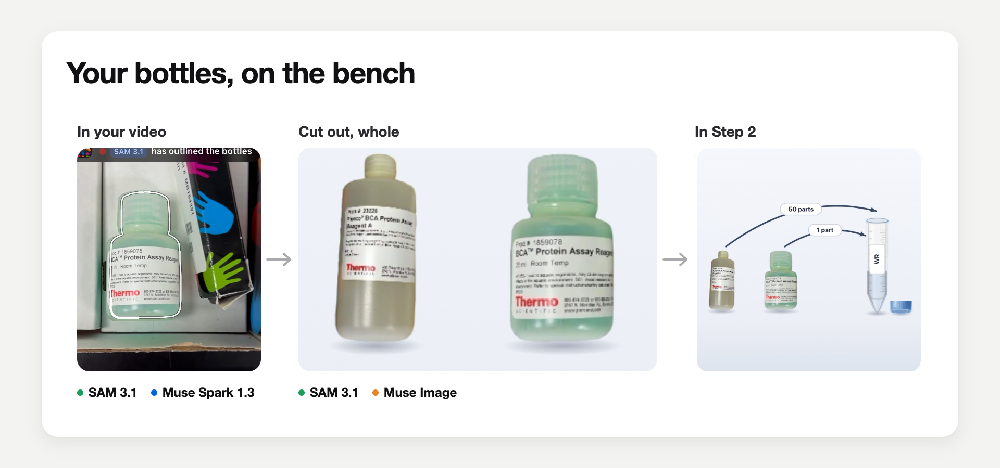

**Two models at once.** While SAM 3.1 is still finding and following the bottles, Muse Spark is already at work on the
same video:

<p align="center">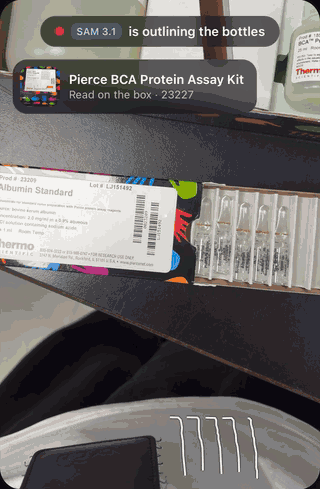</p>

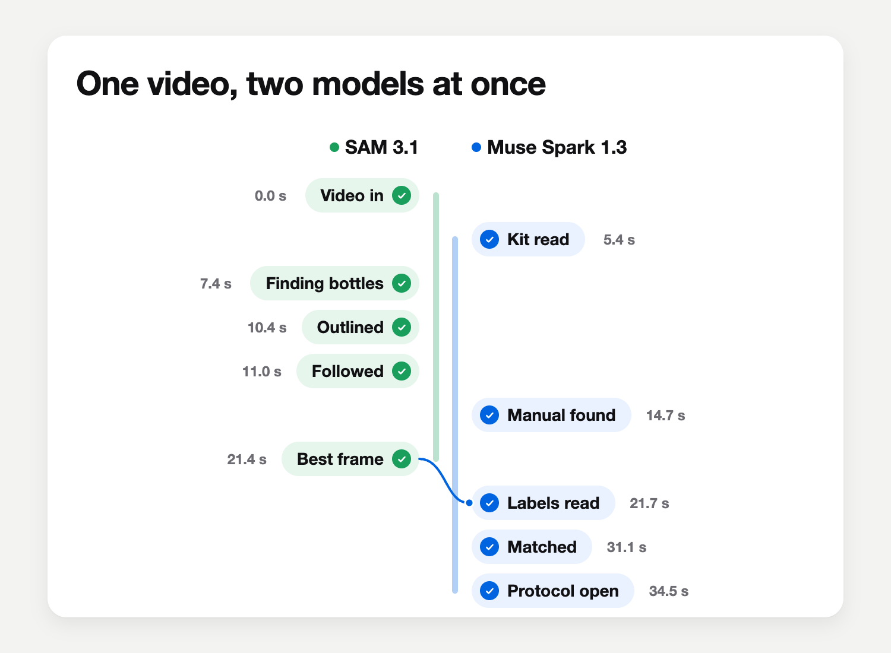

- The video goes to the server a second at a time, while it is still recording.
- Muse Spark reads the kit's box on the first frames (5.4 s) and, while SAM works, finds the vendor's manual on the
  web (14.7 s). The manual says what the kit should hold.
- SAM 3.1 outlines every bottle (10.4 s), follows each one through the video (11.0 s), and hands Muse Spark the best
  frame of each (21.4 s).
- Muse Spark reads the label on each best frame (21.7 s), and every bottle is matched to an item of the manual's list
  (31.1 s): the manual says what to expect, the labels say which bottle is which. A label whose evidence disagrees is
  asked about, never made to fit, and an item no bottle showed waits for the user.
- The protocol opens at 34.5 s, with every bottle known and cut out.

Seconds from the start of the upload, in one run on the user's iPhone (4 November 2026); the manual's time comes from
the server's log of the same video.

## How it's designed

The model understands and proposes; the app checks, computes and decides.

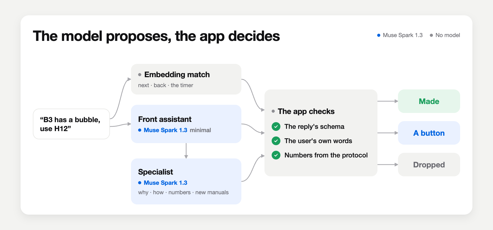

- **Every reply is checked.** Each model reply is checked against a strict schema (Zod) before the app uses it.
- **Only what the user said.** Each change the model asks for is checked against the user's own words
  (`server/ai/authorize.ts`): made when the user asked for it, shown as a button when the user only asked a question,
  dropped otherwise. A sentence that claims a change the app did not make is removed.
- **Numbers come from the app.** Wells, volumes, concentrations, the curve and timer lengths come from the protocol and
  the app (`shared/calc.ts`, `shared/fit.ts`), never from the model.
- **A front assistant and specialists.** A front assistant hears every sentence first, at the lowest effort, and
  finishes chat and bench commands by itself in one call, under two seconds. Why and how, new manuals and numbers go
  to a specialist that continues the same conversation (`server/ai/agents.ts`). The plainest commands (next, back,
  the timer) are matched on the server by sentence embedding and skip the model (`server/ai/router.ts`).
- **One conversation per experiment.** The conversation is the thread through the app and the screens are what it
  opens. Every timer rings from any screen and reaches the lock screen.

## Benchmark

Each model searched the web for the Pierce BCA manual itself and read it into a protocol through the same pipeline:
three runs per setup, timed from the search to the whole protocol, scored on 49 checks against a hand-made protocol
(1 November 2026). The chart has one row per model, its fastest setup that was right in all three runs (or else its
fastest), and Muse Spark 1.3 Mixed, the setting Chapp runs. Muse Spark 1.1 was measured too and is left out, as in the
demo video; every setup is in [How Chapp works](docs/HOW_IT_WORKS.md#the-benchmark-every-setup).

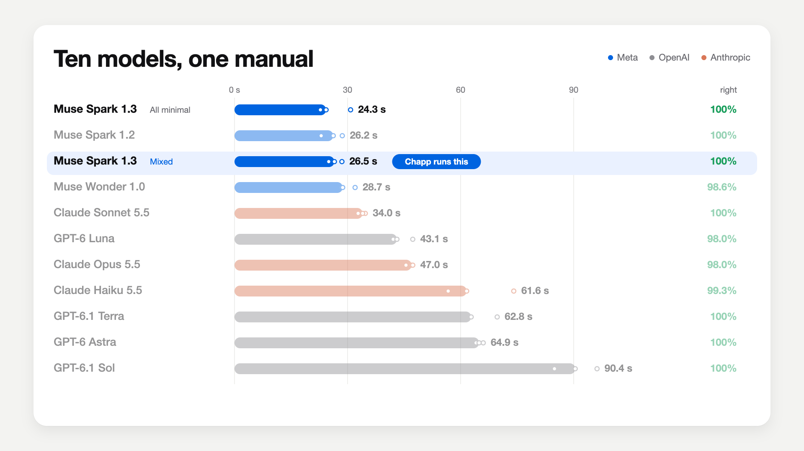

Muse Spark 1.3 at Chapp's setting, Mixed (the steps at low, the rest at minimal), read the whole manual in a median
26.5 s, right on all 49 checks in all three runs, for about $0.09 a manual.

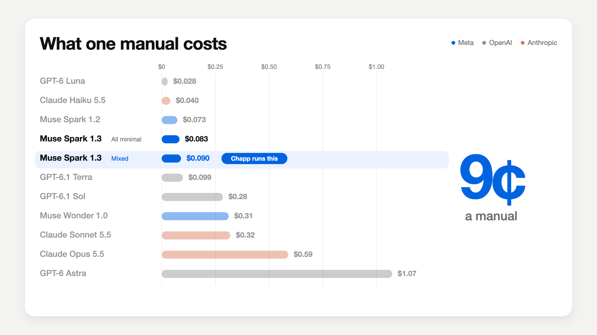

## What the benchmark changed

**What matters first.** One Mixed run, call by call (the median of three, 1 November): the search's intro from the web
is on screen at 4.9 s, the manual's own intro (what the kit is, its main steps, its bottles) at 13.5 s, and the whole
protocol at 26.5 s. Read in one call, the same model shows nothing from the PDF until 30.7 s.

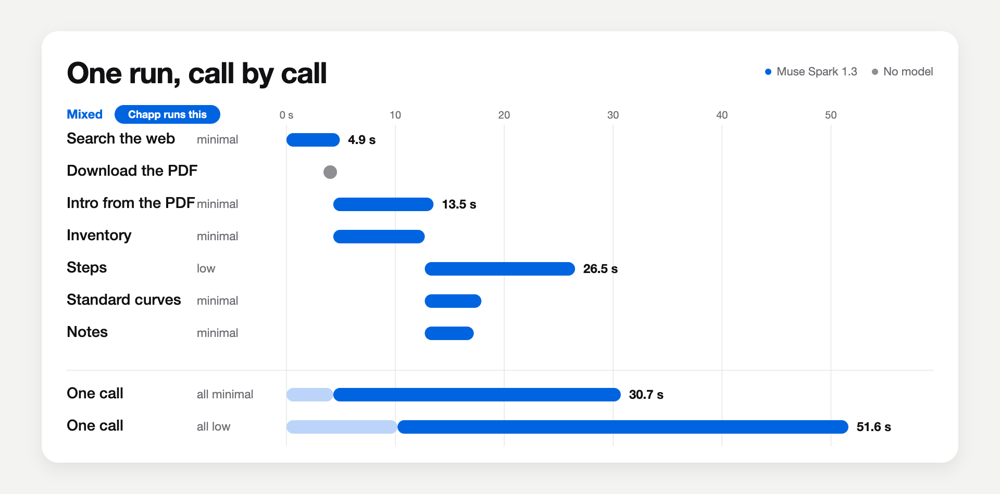

**More thinking is not better.** Muse Spark 1.3 was right on all 49 checks at all three settings; thinking more only
made it slower (1 November, three runs each).

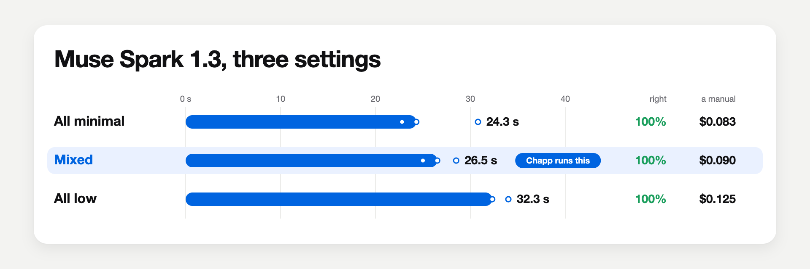

| What changed | What it gave |
|---|---|
| The intro first, the rest read alongside | Something on screen at 4.9 s, not 30.7 s |
| The manual's text instead of the PDF, for every call but the intro | A third of the tokens, about twice as fast |
| The download starts when the search writes the link | A new kit's steps on screen at 10.5 s, not 19 s |
| The search at minimal | Its summary on screen at 6.1 s, not 10.9 s |
| A shorter answer format | About a third less to write |
| Kits and labels read at minimal | The same answers, in half the time |
| A kit video sent to SAM at 720p, 10 fps | An 11 s video followed in 9.3 s, not 31.6 s |
| A science question answered from memory first, then with citations | The first answer at 3.2 s, not 24.0 s |
| The conversation replayed from the server's own record | About 7 s faster per call than continuing Meta's stored response |
| The plainest commands matched by embedding | No model call at all |

Before all of this (28 October, reading only, no search), the whole PDF in every call at medium took 96.6 s with
nothing on screen until done, and thinking more only made it slower: 189 s at xhigh, 215 s at max, with no fewer
mistakes.

Every number, how it was measured, and the rest of Chapp's workings: [How Chapp works](docs/HOW_IT_WORKS.md).

## Run it

Requires Node.js 22.18 or newer (Chapp's server and scripts are TypeScript that Node runs directly).

**With no key**, Chapp runs on its own, with no network and no cost:

```sh
npm install
npm run build           # type check and production build
npm start               # the API and the built app on http://127.0.0.1:3003
npm test                # every check
```

The server answers from fixed BCA data, and a clean checkout starts with a demo copy of the Pierce BCA protocol
(`server/demo/pierce-bca.json`): the steps, volumes, concentrations and timers of the hand-made one, without the
manual's words, each citation naming its page instead. Open the app in a phone-sized window and type "Find the
protocol for Pierce BCA", then Start; at the Read step, **+ → Use the sample export** opens Results and Share on
example readings, marked Sample data.

**With a Meta Model API key**, Chapp finds and reads any kit's manual itself:

```sh
cp .env.example .env    # then put your Meta Model API key in MODEL_API_KEY
npm start               # API on http://127.0.0.1:3003
npm run dev             # app on http://localhost:5175 (forwards /api to the server)
npm run dev:phone       # the same over HTTPS: phones open the microphone and camera only on HTTPS
npm run smoke           # one real call to each Meta model
```

## Data and rights

Vendor manuals are copyrighted. Chapp fetches them from the vendor's own site at runtime and keeps them, their extracted
text and anything derived from them in `data/`, which is never committed. Every fact in a protocol cites the page it came
from, and the tests check that every quoted sentence appears word for word on that page. The demo copy in
`server/demo/` keeps none of the manual's sentences (`scripts/demo-protocol.ts` drops them and checks that no others
are left).

## Built with

- [React](https://github.com/facebook/react), [Vite](https://github.com/vitejs/vite), [TypeScript](https://github.com/microsoft/TypeScript), [Tailwind CSS](https://github.com/tailwindlabs/tailwindcss)
- [React Router](https://github.com/remix-run/react-router), [Zustand](https://github.com/pmndrs/zustand) (state), [Zod](https://github.com/colinhacks/zod) (checking every model reply)
- [Radix UI](https://github.com/radix-ui/primitives), [Sonner](https://github.com/emilkowalski/sonner) (interface parts)
- [three.js](https://github.com/mrdoob/three.js), [React Three Fiber](https://github.com/pmndrs/react-three-fiber), [drei](https://github.com/pmndrs/drei) (3D Chapp)
- [node-qrcode](https://github.com/soldair/node-qrcode), [jsQR](https://github.com/cozmo/jsQR) (sharing by QR code)
- [A2UI](https://github.com/google/A2UI) v0.9 format for the cards Chapp draws (rendered by Chapp's own code)
- [Transformers.js](https://github.com/huggingface/transformers.js) running [multilingual-e5-small](https://huggingface.co/intfloat/multilingual-e5-small) on the server (the embedding fast path for bench commands)
- [Vitest](https://github.com/vitest-dev/vitest), [Puppeteer](https://github.com/puppeteer/puppeteer) (tests and screenshots)

## Layout

- `shared/`: the protocol format (`protocol.ts`, `chapp.protocol/1`), the numbers (`calc.ts`, `units.ts`, `fit.ts`),
  the cards Chapp may draw (`a2ui.ts`) and what a QR code carries (`share.ts`)
- `server/ai/`: the Meta models (`meta.ts`), the front assistant and its specialists (`agents.ts`,
  `conversation.ts`), the embedding fast path (`router.ts`), the checks against the user's words (`authorize.ts`),
  the confirmations (`confirm.ts`) and the mock (`mock.ts`); `server/demo/`: the demo BCA protocol a clean checkout
  starts with
- `src/screens/`: one folder per screen; `src/state/`: the run and the changes Chapp makes to it; `src/voice/`:
  listening
- `src/components/bench/`: the step pictures, and the user's bottles cut out, upright and whole
- `public/chapp/`: the Chapp character (`chapp.glb`, its stills and the app icons), rebuilt from PDB 1SHS by
  `scripts/chapp-model/`
- `scripts/bench/`: the model benchmarks; `tests/`: the protocol format, the numbers, model replies (recorded, replayed
  without a network), voice, the cards and the screens
